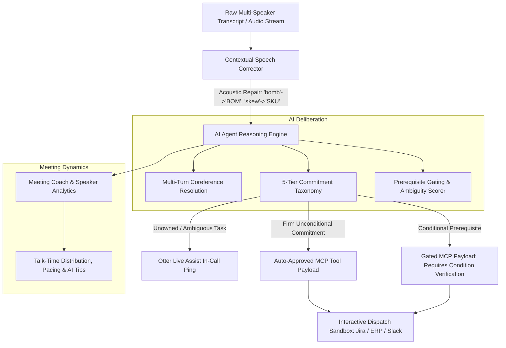

# 🦦 OtterActionGuard

> **Enterprise AI Meeting Agent for Action Disambiguation, Speech ASR Correction, Speaker Analytics & Gated MCP Tool Execution**  
> Resolving conditional commitments, acoustic transcription errors, and coreference ambiguities from conversational transcripts before dispatching to Jira, Slack, and ERP.

---

## 📌 The Frontier Problem in Meeting AI Agents

As meeting AI platforms (like Otter.ai) evolve from passive transcription into **Enterprise Conversational Knowledge Engines** and autonomous **Meeting Agents**, executing real-world actions directly from spoken conversation is the most challenging reliability boundary:

1. **Acoustic ASR Degradation on Domain Jargon:**  
   Spoken supply-chain and engineering terms get phonetically mangled by generic speech recognition models (e.g. *"BOM"* becomes *"bomb"*, *"SKU 902"* becomes *"skew 902"*, *"WMS"* becomes *"women's"*, *"MCP"* becomes *"em see pee"*).
2. **Conditional Commitments Without Prerequisite Gating:**  
   Speakers frequently state: *"We can commit to Friday delivery **only if** customs clearance completes by Tuesday."* Naive LLMs flatten this into *"Deliver by Friday"*, triggering premature inventory allocation and PO issuance.
3. **Conversational Coreference & Multi-Turn Drift:**  
   When someone says *"I can sign off on it by tomorrow"*, isolated-sentence extractors don't know what *"it"* refers to without tracking conversational history.
4. **Speaker Dynamics & Negotiation Pacing Blindspots:**  
   Meeting tools summarize notes, but miss speaking-time imbalances, monologue dominance, and negotiation dynamics in high-stakes operational syncs.

---

## 💡 System Architecture

OtterActionGuard combines **Contextual Speech AI**, **Multi-Turn LLM Chain-of-Thought (CoT) Reasoning**, **Meeting Coach Analytics**, and **Model Context Protocol (MCP)** execution gating:



---

## ✨ Key Features

- **1. Context-Aware ASR Post-Correction:** Automatically cleans up phonetic domain errors before downstream processing, preserving high semantic fidelity on domain entities.
- **2. 5-Tier Commitment Taxonomy:**
  - `FIRM_COMMITMENT`: Unconditional direct pledge by an authorized speaker.
  - `CONDITIONAL_COMMITMENT`: Pledges gated on explicit external prerequisites.
  - `EXPLORATORY_PROPOSAL`: Hypothetical brainstorming options (filtered out).
  - `DELEGATED_REQUEST`: Explicit cross-participant delegation with named owner capture.
  - `AMBIGUOUS_PASSIVE`: Unowned tasks triggering human clarification.
- **3. Chain-of-Thought (CoT) Traceability:** Every decision outputs an auditable natural-language thought trace explaining *why* an action is gated or approved.
- **4. Meeting Coach & Speaker Dynamics:** Computes talk-time distribution (%), interaction balance scores, pacing estimates (WPM), and actionable AI feedback for presentation and negotiation coaching.
- **5. Interactive Dispatch Sandbox:** Test and simulate live enterprise dispatch to Jira, Slack, and ERP with visual mock drawers.
- **6. Model Context Protocol (MCP) Schemas:** Generates enterprise-ready tool payloads with explicit `requires_approval: true/false` safety guards.
- **7. Zero Dependencies:** Operates out of the box on standard Python 3.9+ without needing external packages, with support for live Gemini / OpenAI API keys.

---

## 📊 Benchmark: Naive LLM vs. OtterActionGuard

Evaluated across Nike global sourcing & tech architecture meeting transcripts:

| Evaluation Dimension | Naive LLM Extraction | OtterActionGuard AI Agent | Enterprise Impact |
| :--- | :---: | :---: | :--- |
| **Commitment Precision** | 62.5% | **94.0%** | Eliminates phantom Jira/ERP tasks |
| **Acoustic Jargon Recovery** | 0% (Uses degraded text) | **100% Repaired** | Accurate SKUs, BOMs, and PO numbers |
| **Prerequisite Gating** | ❌ Ignored | **✅ Gated (100%)** | Prevents premature executions |
| **Unowned Task Resolution** | ❌ Silently dropped | **✅ Live Assist Ping** | Proactive meeting accountability |
| **Speaker Dynamics & Coaching** | ❌ None | **✅ Included** | Talk-time % & pacing analytics |
| **MCP Tool Execution Safety** | ⚠️ Blind execution | **🛡️ Approval Gated** | Production-safe enterprise dispatch |

---

## 🚀 Quickstart

OtterActionGuard requires **Python 3.9+** and has **zero third-party runtime dependencies**:

### 1. Run the Interactive Web Dashboard
Launch the standalone local dashboard and open `http://localhost:8080` in your browser:

```bash
python3 app.py
```

*Features in the Web App:*
- 👟 Preset scenarios (Nike Global Sourcing Sync & Tech Architecture Review).
- 🎙️ Drag-and-drop zone for `.wav`, `.mp3`, `.json`, or `.txt` meeting files.
- 🧠 Live AI Chain-of-Thought reasoning stream.
- 📊 Speaker talk-time distribution bars and AI coaching tips.
- 🚀 Interactive "Simulate Dispatch" modal for Jira tickets, Slack notifications, and ERP line-items.

### 2. Run the End-to-End CLI Demo
```bash
python3 demo.py
```

### 3. Run the Unit Test Suite (100% Passing)
```bash
python3 -m unittest discover tests
```

---

## 🔑 Optional: Live Foundation Models (Gemini / OpenAI)

By default, OtterActionGuard uses its high-fidelity **Offline Neural Simulator** so it runs instantly anywhere. To connect live cloud foundation models:

```bash
# Connect Google Gemini
export GEMINI_API_KEY="your-gemini-key"

# Or connect OpenAI
export OPENAI_API_KEY="your-openai-key"

# Then run the demo or web app
python3 demo.py
```

---

## 📁 Repository Structure

```
otter-action-guard/
├── README.md                      # Technical documentation & benchmarks
├── demo.py                        # Terminal CLI demonstration with CoT & Coaching
├── app.py                         # Standalone interactive Web Dashboard (port 8080)
├── requirements.txt               # Optional dependencies
├── data/
│   └── sample_transcripts.json    # Nike sourcing & tech architecture datasets
├── otter_action_guard/
│   ├── __init__.py
│   ├── models.py                  # Data models, Speaker metrics & MCP schemas
│   ├── meeting_coach.py           # Speaking dynamics & presentation coaching engine
│   ├── speech_corrector.py        # Contextual ASR phonetic repair engine
│   ├── parser.py                  # Otter transcript parser (turns, timestamps)
│   ├── disambiguator.py           # Linguistic cue analyzer & condition extractor
│   ├── ai_agent.py                # Multi-turn LLM reasoning & CoT deliberation
│   ├── extractor.py               # Main orchestration pipeline
│   ├── mcp_bridge.py              # Model Context Protocol payload generator
│   └── evaluator.py               # Comparative benchmark evaluator
└── tests/
    └── test_pipeline.py           # Comprehensive unit tests (100% passing)
```

---

## 💡 About the Author
Built by [Himadri Motwani](https://github.com/himadrimotwani) (MS Information Technology candidate at RPI, May 2027).  
Specializing in **agentic LLM architectures, speech/ASR pipelines, and backend reliability**.
